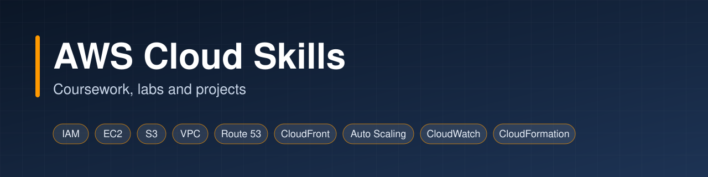
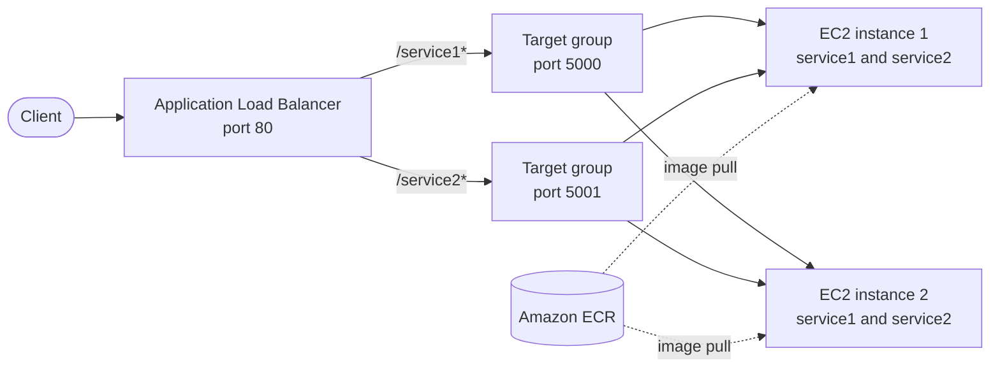

<p align="center">
  
</p>

<p align="center">
  
  
  
  
  
</p>

This repository documents my work in the Cloud Computing course at Southern Methodist University (Spring 2025) and the AWS projects I built alongside it. It contains short study guides for each course module, write-ups of eight hands-on labs with the submitted PDFs as proof of work, and a project that deploys containerized services to AWS.

## Contents

- [At a glance](#at-a-glance)
- [Repository structure](#repository-structure)
- [Skills and evidence](#skills-and-evidence)
- [Hands-on labs](#hands-on-labs)
- [Featured project](#featured-project)
- [Course modules](#course-modules)
- [Security and redaction](#security-and-redaction)
- [Roadmap](#roadmap)
- [About](#about)

## At a glance

| | |
|---|---|
| **Labs** | 8 completed, each with a write-up and a PDF |
| **Study guides** | 11 modules, from IAM to the architectural kata |
| **Project** | Two microservices on EC2 behind an Application Load Balancer |
| **Region** | `us-east-1` |
| **Tools** | AWS Console, AWS CLI, Docker, Docker Compose, Bash |

## Repository structure

```text
.
|-- assets/                  Banner image
|-- modules/                 Study guide, one folder per course module
|   |-- 01-iam/
|   |-- 02-compute-ec2-ebs-efs/
|   |-- ...
|   `-- 11-architectural-kata/
|-- labs/                    Lab write-ups, each with a proof/ folder holding the PDF
|   |-- lab-01-iam/
|   |-- ...
|   `-- lab-08-high-performing-architectures/
`-- projects/
    `-- devops-assessment/   Containerized services on EC2 and an ALB
        |-- docs/
        |-- scripts/
        |-- servers/
        `-- screenshots/
```

## Skills and evidence

| Area | What I worked with | Study guide | Evidence |
|---|---|---|---|
| Identity and access | IAM users, groups, policies, MFA, access keys, permissions boundaries, role assumption | [Module 1](modules/01-iam/) | [Lab 1](labs/lab-01-iam/), [Lab 7](labs/lab-07-secure-architectures/) |
| Compute | EC2, AMIs, launch templates, launching from the CLI | [Module 2](modules/02-compute-ec2-ebs-efs/) | [Lab 2](labs/lab-02-ec2/), [Lab 5](labs/lab-05-ec2-auto-scaling/) |
| Storage and databases | S3 versioning, lifecycle, presigned URLs, static hosting, replication, Transfer Acceleration; RDS read replicas; DynamoDB | [Module 3](modules/03-storage-and-databases/) | [Lab 3](labs/lab-03-storage-and-databases/), [Lab 8](labs/lab-08-high-performing-architectures/) |
| Networking | VPC, subnets, internet gateway, security groups, network ACLs, Elastic IP, transit gateway, Route 53, CloudFront, VPC Flow Logs | [Module 4](modules/04-networking-vpc-route53-cloudfront/) | [Lab 4](labs/lab-04-vpc-route53-cloudfront/), [Lab 7](labs/lab-07-secure-architectures/) |
| Scaling and load balancing | Auto Scaling groups, Application Load Balancer, target groups | [Module 5](modules/05-elb-and-auto-scaling/) | [Lab 8](labs/lab-08-high-performing-architectures/), [DevOps project](projects/devops-assessment/) |
| Monitoring and auditing | CloudTrail, CloudWatch metrics, logs and dashboards | [Module 6](modules/06-monitoring-sns-sqs/) | [Lab 6](labs/lab-06-cloudtrail-cloudwatch-config/), [Lab 8](labs/lab-08-high-performing-architectures/) |
| Security | Least privilege, encryption at rest, network logging | [Module 7](modules/07-cloud-security/) | [Lab 7](labs/lab-07-secure-architectures/) |
| Infrastructure as code | CloudFormation nested stacks | [Module 10](modules/10-infrastructure-as-code/) | [Lab 8](labs/lab-08-high-performing-architectures/) |
| Containers and delivery | Docker, Amazon ECR, Docker Compose, Bash automation | [Module 2](modules/02-compute-ec2-ebs-efs/) | [DevOps project](projects/devops-assessment/) |
| Serverless, big data, architecture | Lambda, Redshift, EMR, Kinesis, architectural kata | [Modules 8, 9, 11](modules/) | Course material only, no lab |

## Hands-on labs

Each write-up lists the exercises completed and the main takeaways. The PDF in each `proof/` folder is the original submission with account identifiers and credentials redacted.

| Lab | Topic | Write-up | Proof |
|---|---|---|---|
| 1 | Identity and Access Management | [README](labs/lab-01-iam/) | [PDF](labs/lab-01-iam/proof/lab-01-iam.pdf) |
| 2 | EC2 | [README](labs/lab-02-ec2/) | [PDF](labs/lab-02-ec2/proof/lab-02-ec2.pdf) |
| 3 | Storage and Database Services | [README](labs/lab-03-storage-and-databases/) | [PDF](labs/lab-03-storage-and-databases/proof/lab-03-storage-and-databases.pdf) |
| 4 | VPC, Route 53 and CloudFront | [README](labs/lab-04-vpc-route53-cloudfront/) | [PDF](labs/lab-04-vpc-route53-cloudfront/proof/lab-04-vpc-route53-cloudfront.pdf) |
| 5 | EC2 Auto Scaling (launch templates) | [README](labs/lab-05-ec2-auto-scaling/) | [PDF](labs/lab-05-ec2-auto-scaling/proof/lab-05-ec2-auto-scaling.pdf) |
| 6 | CloudTrail, CloudWatch and Config | [README](labs/lab-06-cloudtrail-cloudwatch-config/) | [PDF](labs/lab-06-cloudtrail-cloudwatch-config/proof/lab-06-cloudtrail-cloudwatch-config.pdf) |
| 7 | Secure Architectures | [README](labs/lab-07-secure-architectures/) | [PDF](labs/lab-07-secure-architectures/proof/lab-07-secure-architectures.pdf) |
| 8 | High-Performing Architectures | [README](labs/lab-08-high-performing-architectures/) | [PDF](labs/lab-08-high-performing-architectures/proof/lab-08-high-performing-architectures.pdf) |

## Featured project

**[Containerized microservices on AWS](projects/devops-assessment/)** moves two Flask services from local Docker to AWS. Images are stored in Amazon ECR, run with Docker Compose on two EC2 instances, and exposed through an Application Load Balancer that routes by URL path. Deploy, verify and cleanup are scripted.



## Course modules

| # | Module | Focus |
|---|---|---|
| 1 | [Introduction and AWS IAM](modules/01-iam/) | Cloud definitions, shared responsibility, identity and access |
| 2 | [Virtualization and Compute](modules/02-compute-ec2-ebs-efs/) | EC2, EBS, EFS |
| 3 | [Cloud Data Storage](modules/03-storage-and-databases/) | S3, relational and NoSQL databases |
| 4 | [Cloud Networks](modules/04-networking-vpc-route53-cloudfront/) | VPC, Route 53, CloudFront |
| 5 | [Resource Management and Scheduling](modules/05-elb-and-auto-scaling/) | Load balancing, Auto Scaling |
| 6 | [Cloud Applications](modules/06-monitoring-sns-sqs/) | CloudWatch, SNS, SQS |
| 7 | [Cloud Security](modules/07-cloud-security/) | Shared responsibility, secure architecture |
| 8 | [Serverless Computing](modules/08-serverless-lambda/) | Lambda, resilient design |
| 9 | [Big Data and Streaming](modules/09-big-data-and-streaming/) | Redshift, EMR, Kinesis |
| 10 | [Cloud Automation](modules/10-infrastructure-as-code/) | CloudFormation, infrastructure as code |
| 11 | [Architectural Kata](modules/11-architectural-kata/) | Capstone design project |

## Security and redaction

Lab submissions were reviewed and sanitized before publishing. Account identifiers, aliases, access key IDs, secret keys, passwords and personal email addresses have been removed from all documents. Sensitive content in PDFs and screenshots has been redacted: text and underlying pixels were deleted, not merely obscured.

## Roadmap

- [ ] Rebuild the project with Terraform or CloudFormation
- [ ] Add an Auto Scaling group (minimum 2, desired 2, maximum 4) with a CPU-based scale-out policy
- [ ] Add architecture diagrams to the module guides
- [ ] Add the research reports and kata deliverables

## About

This repository documents cloud computing coursework and hands-on AWS projects for Southern Methodist University (Spring 2025). It serves as both a record of work completed and a reference guide for future use. Feedback and suggestions are welcome through [GitHub issues](https://github.com/mmm-byte/Cloud_Computing_AWS/issues).
